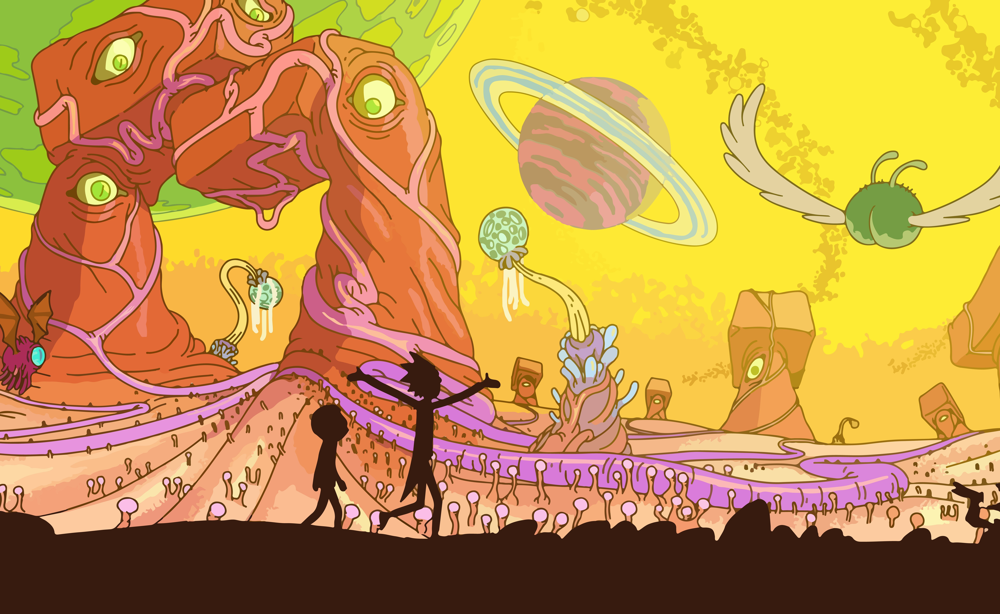
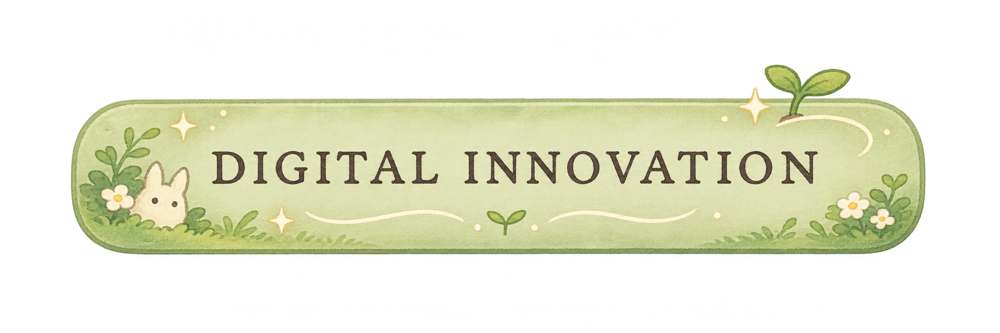
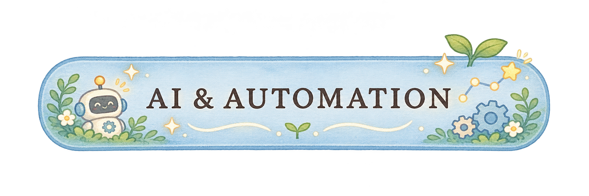
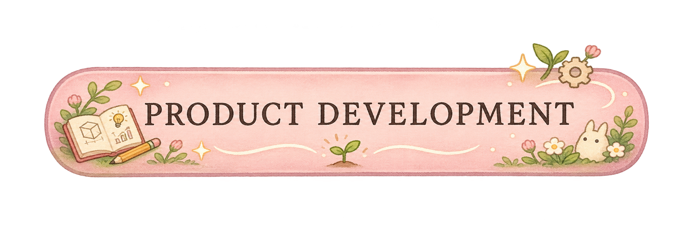
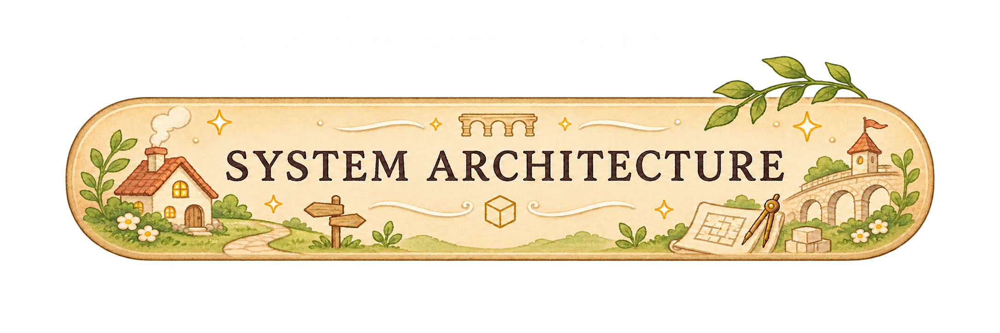

# Hi, I'm Christina!👋

### 🌷 A little about me

I'm interested in the people and business side of technology, and how digital solutions can improve the way we work.

- 🎓 Currently pursuing an MSc in Information Systems at Kristiania
- 💻 BSc in Applied Computer Technology from OsloMet
- 💼 Former technical lead at SEEEK, with experience in product development and IT support
- 🌍 Outside of tech: climbing, nature & traveling

---

### 💻 A few things I've worked on

#### 🏭 Production Line Simulator
GOODTECH · BACHELOR'S THESIS

A web-based application for modelling and simulating production lines, helping users explore production flows and identify bottlenecks.

`React` · `TypeScript` · `.NET` · `PostgreSQL`

 

#### 🚀 SEEEK – Outdoor Gear Marketplace
STARTUP · TECHNICAL LEAD

Helped build an outdoor equipment rental platform, working on product development, technical decisions and user experience.

`React` · `TypeScript` · `Supabase` · `Stripe` · `Firebase` · `Google Gemini`

 

#### 🔐 SikkerVett – Digital Safety Game
EDTECH · CONCEPT & BUSINESS DEVELOPMENT

Developed a game-based learning concept to teach children about online safety, combining UX prototyping with business model development and business planning.

`Figma` · `Design Thinking` · `Business Model Canvas`

---

### 🛠️ Tools & Technologies

*Technologies I've worked with and tools I'm exploring.*

 

&nbsp;

---

### 💫 Things I'm curious about
*From digital innovation to the way technology shapes businesses.*

---

 

