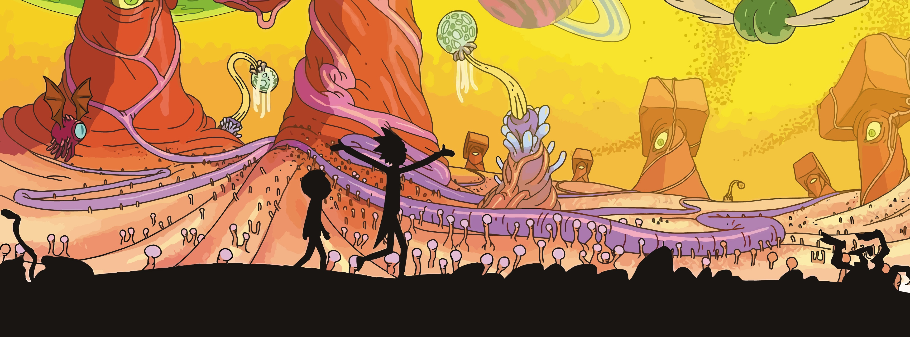

#  Hi, I'm Christina!👋 

### 🌷A little about me

I'm interested in how technology can improve the way we think and work

- 🎓 MSc student in Information Systems at Kristiania, specialising in Digital Business Systems
- 👩🏽‍💻 BSc in Applied Computer Technology from OsloMet
- 🌱 Former technical lead at SEEEK, with experience in product development and IT support
- 🍄 Outside of tech, I like working out, trying new recipes, getting outdoors, travelling, and spending time with my family.

---

### A few projects I've recently worked on

#### [Production Line Simulator](https://github.com/Christinalund/production-simulator-goodtech)
*🏭 Goodtech · Bachelor's thesis*

For my bachelor’s thesis, I led a five-person team where we built a web-based discrete-event simulator for Goodtech. Users can model production lines, analyse KPIs, and identify bottlenecks to test improvements before making changes on the factory floor.

`React` · `TypeScript` · `.NET` · `PostgreSQL`

 

#### SEEEK – Outdoor Gear Marketplace
*🚀 Startup · Technical lead*

I started out building features for SEEEK’s outdoor gear rental marketplace. As technical lead, I set development priorities, tested prototypes with users, and helped add a Gemini feature that drafts rental listings.

`React` · `TypeScript` · `Supabase` · `Stripe` · `Firebase` · `Google Gemini`

 

#### SikkerVett – Digital Safety Game
*🔐 EdTech · Concept and business development*

I helped prototype a game that teaches children about online safety and explored how the concept could work as a business.

`Figma` · `Design Thinking` · `Business Model Canvas`

---

### Tools & Technologies

*Some of the tools I use and technologies I’m exploring*
 

  

---

### Topics I'm curious about

---

 

